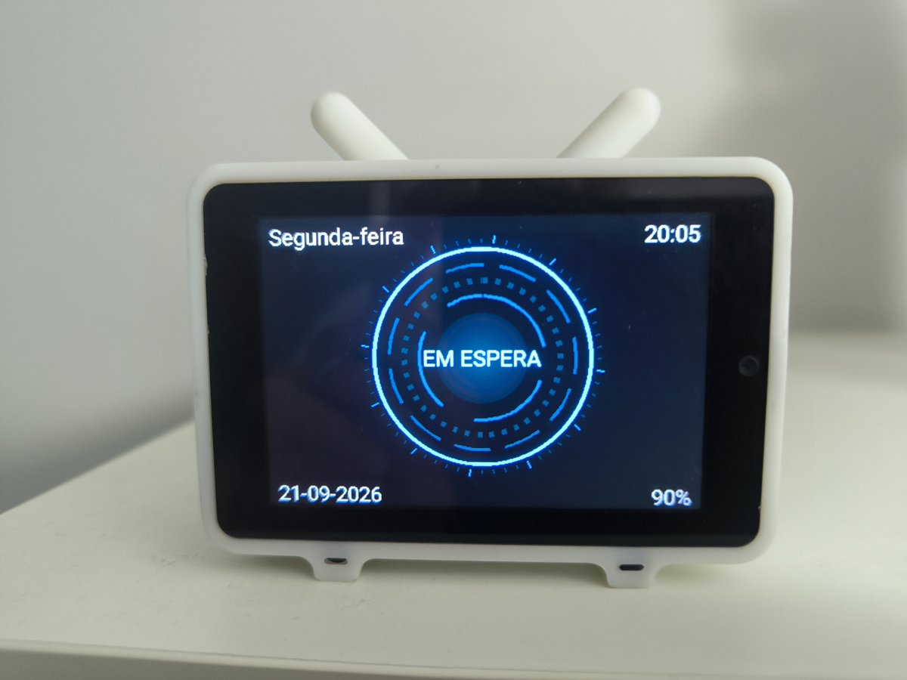
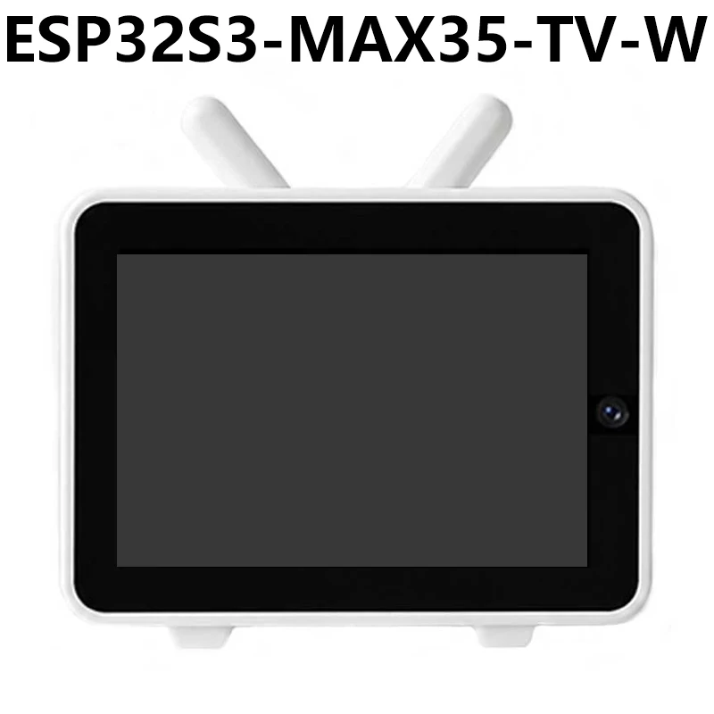
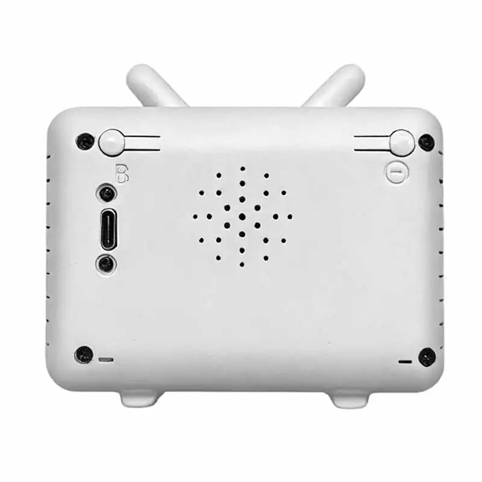
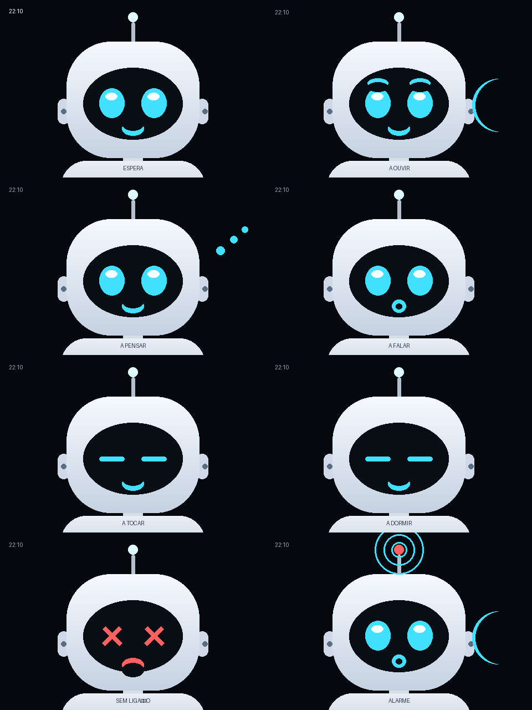

# ESP32-S3 MAX35-TV — Hermes Voice Panel

Turn the **[Spotpear ESP32-S3 MAX35-TV](https://spotpear.com/wiki/ESP32-S3-3.5-inch-LCD-TV-Display-Deepseek.html)**
(3.5" display, dual mic, speaker, battery) into a **local voice assistant for
Hermes Agent**, running as a Home Assistant Assist satellite. Wake word /
push-to-talk → local STT → **Hermes as the HA Conversation Agent** → TTS on the
panel speaker — all local, no cloud, no subscription.

This is a working, verified setup (not a reference skeleton). It reproduces
exactly the configuration running in production: the hardware layer is this
repository; the "brain" is Hermes via
[`rusty4444/hermes-voice-ha-integration`](https://github.com/rusty4444/hermes-voice-ha-integration).

[](LICENSE)
[](https://github.com/byjaps/esp32-max35-tv)
[](https://github.com/byjaps/esp32-max35-tv/releases/latest)
[](https://esphome.io)
[](hardware/README.md)
[](hermes/README.md)
[](docs/troubleshooting.md)

## Features

- **Voice**: **two wake words running side by side** (official `okay nabu` + a
  custom pt-trained `ok hermes`) — four phrasings wake it in practice — or
  push-to-talk (BOOT button ≥600 ms), local STT, Hermes answers and the panel
  speaks back.
- **Screen**: a small **robot face** drawn with **LVGL** (480×320) — head, visor,
  antenna and a chest caption that change with the state: idle, listening,
  thinking, speaking, music, night, no connection and alarm. It blinks, the eyes
  glance up while it thinks, sound waves and thought dots animate, the clock stays
  at full size, and during music the track/station name **scrolls across the
  chest**. Every widget is generated from source in [`geradores/`](geradores/) —
  see [`docs/screen.md`](docs/screen.md).
- **Timer**: three timer slots driven by HA (`timer.*`), with the countdown shown in
  red under the clock and a **10 s alarm** with an animated face at the end. The
  firmware owns the screen and the alarm; the voice side ("set a 10 minute timer")
  is three HA intent scripts + sentences — see
  [`docs/screen.md`](docs/screen.md) §The timer for the entities involved.
- **Agent-written HUD line**: the agent can put **one line of text on the screen**
  without saying it out loud — it embeds a `[HW:/display/info:{"text":"..."}]` marker in
  its reply, the HA conversation component strips it before TTS and writes it to the
  `Linha HUD` entity (auto-clears after 45 s and when a new wake word opens the mic).
  Needs a local patch on the HA component: [`docs/hud-markers.md`](docs/hud-markers.md).
  ⚠️ On the LVGL face the text is written but **not drawn yet** — the entity and the
  marker pipeline work, the widget is pending.
- **Conversation mode**: after each answer the panel reopens the microphone for
  **7 s**, so follow-up phrases need no wake word. The chain is capped by a
  `number` entity (**10** by default, 0 disables it) — the cap is a safety brake,
  not a usage limit. Details: [`docs/performance.md`](docs/performance.md) §2b.
- **Fast local commands**: plain home commands are answered by HA's own intent
  engine in **0.01-0.2 s**, never by the LLM (multi-command sentences and
  transcribed noise are handled locally too — see `docs/performance.md` §2).
- **Media player**: the panel speaker is a HA `media_player` — announcements,
  TTS messages and radio/music work. The screen switches to the robot listening to
  music (closed eyes, notes) and the title scrolls on the chest; the name comes
  from the URL the panel receives, with a small HA-side service filling it in for
  Radio Browser stations (which have no URL of their own) — see
  [`docs/media-player.md`](docs/media-player.md).
- **Battery**: real voltage ADC (GPIO6) with a Li-ion %, plus charging status.
- **Volume**: one source of truth, sized UI scale → audible floor →
  distortion ceiling, survives reboots.
- **Button gestures**: single click = volume +10%, double click = volume −10%,
  long press = push-to-talk.

## Hardware

- **Board**: Spotpear ESP32-S3 MAX35-TV (`ESP32S3-MAX35-TV-W`) — ESP32-S3,
  3.5" ST7796S (480×320) display, ES7210 dual mic + ES8311 speaker codecs,
  GC0308/OV5640 camera slot, microSD slot, battery connector, type-C.
- **Official resources** (datasheets, schematic, 3D model, factory firmware,
  user guide) are linked from [`hardware/`](hardware/README.md).
- Correct wiring/pins are verified against the manufacturer's own ESPHome file
  (`RealDeco/xiaozhi-esphome`, `spotpear-tv_hw.yaml`) — do not trust
  LLM-generated pinouts for this board.

### Where to buy

The board is sold under the "mini TV" camera-and-voice devboard family. On
**AliExpress** just search **"Xiaozhi max tv"** (the board ships with XiaoZhi
firmware, hence the name). The MAX35-TV-W is the 3.5" reversion here.

### Photos

| | |
|---|---|
|  |  |
| Real panel (photo taken on the earlier ring HUD, v0.15.x) | Front view (AliExpress) |
|  |  |
| Board view (AliExpress) | The robot face — 8 states, rendered from the generator |

The previous **round-face HUD** (ring + centre clock, the series up to v0.15.27) is
still buildable from the [`v0.15.27`](https://github.com/byjaps/esp32-max35-tv/releases/tag/v0.15.27)
tag; the robot face starts at v0.16.0 and is what the current releases ship.

### Disabled features

Some board hardware is deliberately not enabled in this firmware. See
[`docs/disabled-features.md`](docs/disabled-features.md) for rationale and how
to re-enable:

- **Camera** — removed (no IR = blind at night, ESPHome does no image motion
  detection, and it cost RAM/flash/PSRAM). Disabled in the YAML.
- **microSD card** — not configured in this firmware (SD video/music are
  XiaoZhi features and do not exist here).
- **Touch** — this device revision has no GT911 touch controller; the panel is
  voice + HUD only.

## Getting started

**You need**: Home Assistant (with an Assist pipeline) and this panel. Building the
firmware yourself needs ESPHome **2026.10.0** (Python 3.12+); or just hand the
repository to an agent and let it do the whole thing (below).

### Easiest — hand it to your Hermes agent

If you already run **[Hermes Agent](https://github.com/NousResearch/hermes-agent)**
(or any agent with shell access and your Home Assistant credentials), you don't
have to do any of the steps below by hand: give it this repository and let it
configure the panel. It can clone the repo, create `secrets.yaml` (generating the
`api_encryption_key`), adjust the device name, compile with ESPHome and push the
OTA over the network — and then confirm on the board which version is actually
running instead of trusting the upload.

Something like this is enough:

> Clone `https://github.com/byjaps/esp32-max35-tv` and set up the MAX35-TV voice
> panel for my Home Assistant. Build with ESPHome 2026.10.0, create the secrets
> file, flash it over the network, then confirm on the device which firmware
> version is really running.

The repo is built for that: the YAML is self-contained (no hard-coded network,
names or secrets), `scripts/` speaks both the ESPHome API and HA, and
[`docs/troubleshooting.md`](docs/troubleshooting.md) hands the agent the honest
checks (what firmware is really running, why the I2S bus gets busy, why the first
flashes reboot).

### Or by hand — two ways

#### Option A — flash a pre-built binary

Not available: this repository ships the firmware as **source only**. An ESPHome
binary carries the whole configuration it was compiled with (network, API), so
binaries are not shared here — use one of the two paths below. Compiling takes a
few minutes and the agent path needs nothing else.

#### Option B — build and flash it yourself

1. **Flash ESPHome** onto the board (original firmware is XiaoZhi). See
   [`docs/setup-hermes.md`](docs/setup-hermes.md).
2. **Configure** `secrets.yaml` (copy `secrets.yaml.example`) and adjust names.
3. **Compile + OTA** the YAML: `esphome run esp32-max35-tv.yaml`.

### Either way — Home Assistant side

4. **Install the HA integration** (Hermes as Conversation Agent) —
   [`hermes/`](hermes/README.md).
5. Set up the Assist pipeline to use Hermes as its conversation agent, and select
   the panel as the satellite that uses that pipeline.

> ✅ **Builds and runs on ESPHome 2026.10.0** (the current release). The board
> runs it stable for hours. Validate any change with `esphome config` before
> flashing. After any flash the panel may reboot 2–3 times in the first ~45 min
> while the new image settles — that is expected, not a defect
> ([`docs/troubleshooting.md`](docs/troubleshooting.md)).

## Repository layout

```
esp32-max35-tv.yaml      ESPHome firmware (generated — no secrets)
geradores/               generator for the LVGL screen + frozen v0.15.27 base
secrets.yaml.example     credentials template (copy to secrets.yaml)
hardware/                official datasheets/schematic + links
scripts/                 diagnostics/helpers (check panel, battery, preview)
assets/                  screen renders + product photos
docs/                    setup + hardware-specific guides
hermes/                  Hermes <-> HA voice integration (rusty4444)
```

`esp32-max35-tv.yaml` is **generated**: `python3 geradores/monta_lvgl.py` rebuilds it
from the frozen pre-LVGL base plus the screen generator, and the output is
byte-identical to the file in this repo. Edit the generator, not the YAML, when
changing the screen; `scripts/preview_lvgl.py` renders the result offline.

## Credits

This project stands on the shoulders of several people:

- **[`rusty4444`](https://github.com/rusty4444) (Sam Russell)** —
  [`hermes-voice-ha-integration`](https://github.com/rusty4444/hermes-voice-ha-integration):
  the HACS component that makes **Hermes** the HA Conversation Agent. It is the
  brain of this voice panel. Includes merged `byjaps` PRs [#42](https://github.com/rusty4444/hermes-voice-ha-integration/pull/42)
  (WebSocket reconnect), [#46](https://github.com/rusty4444/hermes-voice-ha-integration/pull/46)
  (instant local intent answers) and [#47](https://github.com/rusty4444/hermes-voice-ha-integration/pull/47)
  (empty transcripts no longer reach the agent).
- **Spotpear** — the board, the official wiki and the hardware documentation.
- **[`RealDeco/xiaozhi-esphome`](https://github.com/RealDeco/xiaozhi-esphome)** —
  the reference ESPHome config for this board (pins, codecs, wake word).
- **[`eadmin2/jarvis_ai`](https://github.com/eadmin2/jarvis_ai)** — the design
  behind both screens: the "arc reactor" HUD of the earlier series and the robot
  face with its animations (blink, glance, sound waves, thought dots, notes, "Z",
  alarm rings), re-drawn as LVGL widgets measured from its mockups.
- **[`miketomkins`](https://github.com/miketomkins/hey-hermes-wakeword-model)** —
  the "hey hermes" wake word model (tested, not retained; see `docs/wake-word.md`).
- **[microwakeword.com](https://microwakeword.com)** — the wake word **library and
  training service** (community models at
  [microwakeword.com/library](https://microwakeword.com/library)) that produced
  the `ok hermes` model shipped in `models/`. Built on
  [`kahrendt/microWakeWord`](https://github.com/kahrendt/microWakeWord) by Kevin
  Ahrendt; the official models come from
  [`esphome/micro-wake-word-models`](https://github.com/esphome/micro-wake-word-models).

## Built with Hermes Agent

Everything in this repository — the firmware, the HUD, the diagnostics and the
docs — was built and debugged with
**[Hermes Agent](https://github.com/NousResearch/hermes-agent)**, the same agent
this panel talks to on the Home Assistant side. It runs on the
**[Nous Portal](https://portal.nousresearch.com)** (200+ models, hosted tools,
monthly credits).

If you are signing up: **new accounts get $15 off their first month** through
this invite link —
**[portal.nousresearch.com/r/byjaps](https://portal.nousresearch.com/r/byjaps)**

## Documentation

- [`docs/setup-hermes.md`](docs/setup-hermes.md) — flashing + wiring the panel to Hermes
- [`docs/wake-word.md`](docs/wake-word.md) — the two wake words, where to get more, cutoffs, false triggers
- [`docs/performance.md`](docs/performance.md) — voice latency: measurements, the watchdog, and where the real wins are
- [`docs/screen.md`](docs/screen.md) — the LVGL robot face: states, animations, how it is generated and what breaks it
- [`docs/audio.md`](docs/audio.md) — shared I2S bus, ES8311 DAC, volume, TTS
- [`docs/battery.md`](docs/battery.md) — battery ADC, charge curve, charging
- [`docs/media-player.md`](docs/media-player.md) — media player, metadata, announcements
- [`docs/disabled-features.md`](docs/disabled-features.md) — camera / SD / touch
- [`docs/hud-markers.md`](docs/hud-markers.md) — one line of text on screen, written by the agent, never spoken (needs a small HA component patch)
- [`docs/troubleshooting.md`](docs/troubleshooting.md) — the hard-won pitfalls

## License

[MIT](LICENSE). The firmware is yours to reuse; the third-party components keep
their own licenses (see Credits).